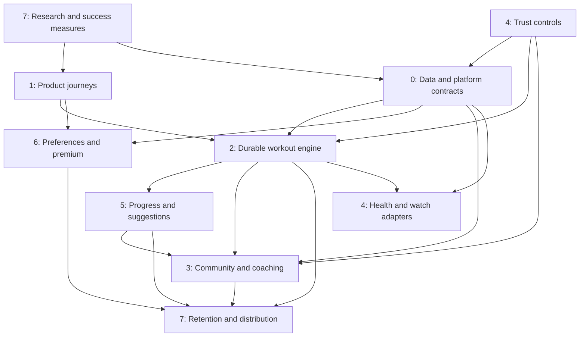

# PLZ FitZone — from prototype to a fitness product people choose

**Planning baseline: 2026-10-14. Status: roadmap only; implementation has not started.**

**Current direction: personal use first.** Build toward a dependable tracker for your own routines, logging and progress. Hevy supplies the workflow reference. Community, paid guidance, coaches and industry-wide distribution remain optional future expansion; they are not requirements for your personal app.

The immediate priority is **trustworthy workout logging**. The prototype already covers the basic loop, but reload loses a live workout and the KG/LBS toggle changes the meaning of recorded loads. No feature expansion should outrun correcting those foundations.

Evidence and timestamped references: [research/HEVY_AUDIT.md](research/HEVY_AUDIT.md). Execution rules: [../AGENTS.md](../AGENTS.md). Session history: [PROGRESS_LOG.md](PROGRESS_LOG.md).

**Feature handoff:** each pillar task has a **Feature references** link to its own exact scenes and evidence limits. The [video reference index](research/VIDEO_REFERENCE_INDEX.md) covers both supplied videos, distinguishes demonstrations from settings/narration, and identifies features not covered. Start with the task's clips instead of watching an entire review.

## 0. Personal-use roadmap — the active plan

The user's clarification on 2026-10-14 supersedes the public-launch priority order. **Focus on pillars 0, 2, 1 and 5**, with the minimum relevant work from 4 and 6. Keep the current web prototype unless personal device/lifecycle needs demonstrate a reason to move. A backend, accounts, native rewrite and interviews are not prerequisites.

| Order | Focus | Personal outcome | Relevant tasks |
| --- | --- | --- | --- |
| 1 | Pillar 0 + core Pillar 2 contracts | Sessions survive refresh; backups are recoverable; weights retain their meaning | P0-01/02/03, P2-01/02, P5-01, P4-01 |
| 2 | Pillar 2 | Edit and duplicate your own routines; log sets quickly; accurate rest and previous performance | P2-03/04/05/07; catalogue work P2-06 limited to movements you actually use |
| 3 | Pillar 1 | Comfortable logging on your actual phone; clear resume/error states and accessible controls; personal first-run setup (P1-05) after the data-safety work | P1-01/02/03/04/05; preserve useful existing tabs rather than adding an empty social Home |
| 4 | Pillar 5 | Detailed history, meaningful PRs, simple exercise trends and a training calendar | P5-01/02/03; optional private measurements from P5-04 |
| 5 | Basic pillars 4 and 6 | Safe imports, predictable timer behavior and your unit/rest/display preferences | P4-01/03 and relevant P4-04 export/retention choices; P6-01 |
| Later, only if useful | Selected sync/device/guidance tasks | Move between your own devices or obtain explainable optional targets | P0-05 after an explicit sync/account decision; P4-06/07 and P5-05 individually scoped |

These priorities overlap where contracts depend on each other: define metric/unit semantics before persistence migration, specify the logger before changing interactions, and add charts only after the underlying data is correct.

The second-video review adds focused detail within the same pillars: **P2-11** previous values from any workout versus the same routine; **P2-12** optional inline timed sets/superset advancement; **P2-13** custom exercise demos and muscle metadata; **P4-10** optional keep-awake; **P6-08** separate audio feedback. Choose them when useful after the core logger is reliable. **P5-09** population strength comparisons stay deferred unless requested. No new pillar is necessary; the backlog now contains **76 future tasks**, all unimplemented.

### Personal milestones

1. **Trust the data:** no lost acknowledged sets after refresh/reopen; no duplicate finalization; KG/LBS preserves physical load; invalid imports leave the original untouched; a backup/restore round trip is verified.
2. **Use it at the gym:** your actual routines can be edited, started, logged and resumed on your phone; rest uses deadlines; previous values are reliable. Curate only the exercises needed for your plan initially.
3. **Understand progress:** inspect complete sessions, correct mistakes, compare exercise performance over time, and view your training calendar with defined record rules.
4. **Prove personal usefulness:** use it across several real sessions, including interruptions and weak connectivity, and fix the friction you encounter. Keep a simple private feedback log; acquisition analytics and cohort retention instrumentation are unnecessary now.

**Defer entirely:** Pillar 3 community/coaching; Pillar 7 public distribution/customer acquisition; Pillar 6 subscriptions/paywalls; discovery feeds, marketplaces, referrals and public-launch research. Defer cloud identity/sync unless you need your own devices to share data. No deployment, account creation or implementation is part of the current documentation publication.

The remaining sections preserve the larger vision from the original brief. Their public-release phase letters, customer interviews, cohort gates and business targets are future reference, not blockers for personal use. Pillar task tables retain those phase labels; select only the personal subsets above.

## 1. Future public-product thesis and initial customer

**Proposed promise:** “Know what to do next, log it in seconds, and see why you are progressing.”

Start with self-directed strength trainees following recurring routines who currently use a notebook, spreadsheet, or logger. Their proposed jobs are: remember previous performance, adjust a session when equipment is occupied, preserve their history, and know the next sensible target. This is an initial customer hypothesis, not validated demand.

Expand later to beginner programs, accountability groups, and coaches. The fitness industry includes many different needs; early success in one segment is a better milestone than launching every training, nutrition, recovery, and medical feature at once.

Four proposed reasons to switch must be tested:

1. **Training history moves with you:** previewed imports, verified conversion, transparent mapping, complete export.
2. **Progression you understand:** next-session targets explain the relevant evidence and allow user control.
3. **Adaptation at the gym:** useful equipment substitutions and shorter-session options that preserve the intent of a plan.
4. **Accountability with useful context:** small groups and coach feedback tied to actual sessions, without interrupting the logger.

Hevy already offers adaptive training and a ChatGPT integration. These hypotheses cannot rely on “we have AI” as a differentiator. Validate the combined workflow against alternatives. [Official Trainer description](https://www.hevyapp.com/features/workout-plan-generator/), [official ChatGPT integration](https://www.hevyapp.com/features/hevy-chatgpt/).

“Most demanded” is the ambition. The operational definition is repeat training, satisfied users, referrals, and sustainable payment; no roadmap can guarantee category leadership.

## 2. Starting point and first priorities

| Area | Current state | First upgrade |
| --- | --- | --- |
| Runtime | One vanilla HTML/CSS/JS file; no tooling | Agree platform, domain contracts and meaningful checks |
| Persistence | Browser-local completed data; in-memory active session | Durable draft, error handling, versioned migration |
| Units | Global label, no numeric conversion | Canonical load + input unit provenance; safe legacy review |
| Logging | Basic weight/reps, previous values, set types | Reliable session lifecycle, correct types, per-exercise rest |
| Routines | Create/start/delete and PPL presets | Edit, duplicate, reorder, prescription targets, folders |
| Catalogue | 15 movements, six broad muscles | Curated metadata, filters, instructions and owned/licensed demos |
| Progress | All-time totals, estimated records, bars | Definitions, detailed history, trends, calendar and reports |
| Account/community | None | Optional identity and sync first; deliberate sharing later |
| Business | None | Interviews, activation/retention instrumentation, priced experiments |

**Priority convention:** P0 = blocks reliable use or release; P1 = core product and retention; P2 = differentiation or controlled growth; P3 = expansion after evidence. These priorities are separate from pillar numbers.

## 3. Eight domain pillars

Eight preserve the originally intended consumer product, rather than reflecting the size of today's prototype. For current personal use, prioritize pillars 0, 2, 1 and 5, with basic trust and preferences from 4/6. Pillars 3/7 and commercial portions of 6 are deferred. Nothing in these documents authorizes implementation yet.

| Pillar | Roadmap file | Responsibility | Trigger keywords | Initial status |
| --- | --- | --- | --- | --- |
| 0 — Core architecture & data | [00_CORE_ARCHITECTURE.md](pillars/00_CORE_ARCHITECTURE.md) | Durable data, migration, identity, sync, engineering delivery | architecture, database, migration, offline, sync | Critical planning |
| 1 — Product UI & design | [01_UI_DESIGN.md](pillars/01_UI_DESIGN.md) | Hevy-familiar journeys, original design system, accessibility | screens, navigation, logger, design | Core planning |
| 2 — Workout engine | [02_WORKOUT_ENGINE.md](pillars/02_WORKOUT_ENGINE.md) | Routines, sessions, catalogue, timers, typed training data | workout, exercise, routine, sets, rest | Core planning |
| 3 — Community & coaching | [03_COMMUNITY_COACHING.md](pillars/03_COMMUNITY_COACHING.md) | Sharing, accountability, social graph, coach collaboration | feed, friends, groups, coach | Deferred for personal use |
| 4 — Trust & integrations | [04_TRUST_INTEGRATIONS.md](pillars/04_TRUST_INTEGRATIONS.md) | Secure rendering, privacy, moderation, device adapters | security, privacy, health, watch | Core protections first |
| 5 — Progress & intelligence | [05_PROGRESS_INTELLIGENCE.md](pillars/05_PROGRESS_INTELLIGENCE.md) | Accurate metrics, insights, optional adaptive guidance | records, charts, analytics, progression, AI | Personal records/charts; guidance later |
| 6 — Settings & premium | [06_SETTINGS_BILLING.md](pillars/06_SETTINGS_BILLING.md) | Preferences, accounts, entitlements, billing | settings, units, subscription, premium | Preferences first; billing later |
| 7 — Distribution & growth | [07_DISTRIBUTION_GROWTH.md](pillars/07_DISTRIBUTION_GROWTH.md) | Research, activation, retention, channels, economics | launch, demand, onboarding, retention | Deferred for personal use |

Workout data management belongs to pillar 0; social entities and relationships belong to pillar 3. Security/privacy owns its policy in pillar 4; domain owners enforce it. Enterprise CRM/inbox, employer wellness, multi-tenant gym administration, nutrition tracking, rehabilitation, and marketplaces are omitted from the initial architecture because they are not needed for the chosen product loop.

## 4. Future public-product dependency graph and sequence

Read arrows as readiness dependencies, not a requirement to finish an entire pillar. Trust policy and research start immediately. Growth experiments recur throughout. Device adapters follow reliable data/session contracts. Runtime dependencies must not create circular imports.

**Recommended sequence:** 7 discovery + 0/4 contracts → 1/2 reliable logger → 0 account/sync + 5 progress → 3 sharing/community → 5 adaptive guidance + 6 paid value → 4 device expansion + 7 scale.

Any change to session units, record eligibility, privacy audiences, subscriptions, or shared controls must cross-reference the affected pillars.

## 5. Optional public-expansion roadmap with exit gates

Calendar ranges below are **illustrative effort envelopes**, assuming 2–3 experienced engineers, design/product support, part-time content/fitness expertise, and a constrained launch platform. Phases total roughly 7–12 months to a broader product if gates pass; a solo effort can take considerably longer. They are not commitments. Discover the actual team, budget, supported devices and release market before scheduling. Research and design can overlap; data dependencies cannot be skipped.

| Phase | Illustrative duration | Ship later, after authorization | Exit gate |
| --- | --- | --- | --- |
| A — Decide and validate | 1–2 weeks | Customer problem, first platform, architecture/migration decisions, logger prototype specifications | 15 interviews and 5 observed workflow sessions; decision log; scoped beta backlog |
| B — Trustworthy solo logger | 4–6 weeks | Durable draft, unit fixes, safe import, typed sets, session conflicts, correct timers, routine editing, accessible logger | No lost or duplicated sets in interruption/restore suite; unit invariants pass; 10 testers complete sessions unaided |
| C — Private beta people return to | 6–8 weeks | Account/guest migration, sync, curated catalogue, detailed history, calendar and core charts, onboarding | 50–100 invited trainees; 4-week cohort observed; sync/privacy gates pass; proposed retention target met |
| D — Shareable community product | 8–12 weeks | Explicit sharing, routine links/copy, following feed, basic groups, notifications and moderation | Publishing never blocks save; audience tests pass; sharing leads to measured activation without degrading logging |
| E — Guidance and paid value | 8–16 weeks | Equipment/time adaptation, reviewed progression rules, explainable weekly insights, subscriptions; small coach pilot | Controlled evaluation shows useful guidance; no silent plan edits; paid demand and cost-to-serve measured |
| F — Expand what works | Ongoing, evidence-led | Next mobile platform, health adapters, Apple Watch/WearOS, coach expansion, localized distribution | Each adapter's reconciliation/privacy checks pass; retained acquisition and unit economics remain healthy |

**Hevy core workflow parity** is the objective of phases B–D. Full ecosystem parity, including watches and coach tooling, is phased after that. An AI assistant, open discovery feed, video analysis and a marketplace are not phase-B dependencies.

### Phase B minimum useful product

A returning trainee opens the app offline, starts a saved routine, edits loads/reps, sees previous performance, marks sets, uses exercise-specific rest, swaps an exercise, recovers after an interruption, finishes, and reviews accurate history. It must work without social onboarding or a subscription. JSON backup remains recoverable through migration.

### Stop and repair rules

- Any confirmed loss of a completed workout, silent unit corruption, cross-account data access, or duplicate finalization blocks release.
- If 4-week retention misses the proposed target, improve onboarding, logging and progress understanding before funding broad acquisition.
- If the chosen differentiator does not produce measurable preference in trials, revise the thesis before building additional AI features.
- If health/watch reconciliation cannot preserve exactly one logical session, postpone that adapter.
- If sustainable paid demand is absent, iterate package/value and costs before committing to lifetime pricing or a coach marketplace.

## 6. Hevy parity checklist and deliberate improvements

The reference review supplies the interaction sequence; current official feature pages supply today's benchmark. The following are **our proposed release priorities**. Detailed behavior is owned by the linked pillars; this table does not imply implementation.

| Capability | Prototype | Target release | Owner |
| --- | --- | --- | --- |
| Empty and routine workout, previous set, completion | Partial | B: reliable and recoverable | 0, 2 |
| Weight/reps and set types | Partial | B: validated types and complete add/remove/edit | 2 |
| Per-exercise rest and adjustment | Global only | B: durable deadlines and clear state | 2, 4 |
| Notes, supersets, reordering, replacement | Missing | B core / C advanced polish | 1, 2 |
| Routine edit/duplicate/folders/prescriptions | Create/delete only | B edit/duplicate; C folders/programs | 2 |
| Equipment/muscle picker, multi-select, movement detail | Text search only | B picker; C curated content | 1, 2 |
| Finish review, optional template update, summary | Immediate save | B clear save; C summary and template choice | 1, 2 |
| Detailed history, calendar, records, charts | Summary only | C | 5 |
| Private measurements/photos and reports | Missing | C basic measurements; D photos/reports | 4, 5 |
| Identity, cross-device routine/history access | Missing | C | 0 |
| Profile, following, feed, reactions, routine sharing | Missing | D | 3, 4 |
| Curated program exploration | Three presets | C | 2 |
| Adaptive programs and conversational analysis | Missing | E, validated against existing competitors | 2, 5 |
| Account settings, optional premium | Basic local settings | C account controls; E paid package | 6 |
| Web planner, health, watch, widgets/live activities | Static web only | F, individually scoped | 0, 1, 4 |
| Migration preview, ambiguity disclosure, open export | JSON only | B JSON; C standard importer pilot | 0, 4 |
| Explainable targets + equipment/time constraints | Missing | E differentiation trial | 2, 5, 7 |

Detailed references: [routine editing](https://www.hevyapp.com/features/gym-routines/), [exercise catalogue](https://www.hevyapp.com/features/exercise-library/), [progress](https://www.hevyapp.com/features/gym-progress/), [feature index](https://www.hevyapp.com/features/).

## 7. Product structure: personal now, community later

For personal use, keep the useful **Workout / History / Exercises / Profile** organization and improve the connected logger/detail flows. The reference's **Home / Workout / Profile** navigation becomes an option only if community launches; do not add an empty social Home now.

- **Home:** following feed and group/accountability updates; one useful personal next-action card when a user follows nobody.
- **Workout:** quick start, persistent active session, routines/folders, explore programs, full-screen logger, finish review.
- **Profile:** history/calendar, exercise library, progress/records, measurements, optional private photos, settings and account controls.
- **Exercise detail:** summary, personal history/charts, instructions; reachable from the logger and picker without losing entered data.
- **Desktop:** routine/program planning and history analysis using the same contracts; no second independent data model.

Design through journeys and empty/error/loading/offline states before polishing isolated screens. Use numeric keyboards, clear previous values, visible set completion, large touch controls, restrained celebrations, and optional haptics. Exercise demonstrations must be created or licensed; competitor media is reference material.

## 8. Architecture direction and migration

**Personal-use default:** retain the existing web app and choose the smallest structural change that makes drafts, unit semantics and imports reliable. Evaluate durable browser storage, an offline install/cache strategy and focused domain regression checks before considering a framework or native client. Keep manual backups useful. Cross-device sync, cloud accounts and native platform work are optional later decisions.

**Recommendation to evaluate, not an implementation decision:** a shared typed domain layer, a mobile client designed for durable offline operation, and a managed relational backend for identity, sync, media references and permissions. Evaluate React Native/Expo with SQLite for mobile and a web planning client against a PWA-first route. The [official SQLite API](https://docs.expo.dev/versions/latest/sdk/sqlite/) documents restart persistence, but adapters and sync still require separate design.

Choose after testing the required keyboards, background timer/notification behavior, install path, accessibility and target device. A web prototype can validate workflows quickly; Apple Watch/WearOS and native lifecycle features need platform work. Avoid committing to a rewrite, cloud vendor or package version in this planning session.

### Core proposed entities

| Entity | Required distinction |
| --- | --- |
| ExerciseDefinition | Stable ID, modality, equipment, primary/secondary muscles, content rights/version |
| RoutineVersion / RoutineExercise / SetPrescription | Intended exercise order, targets, rest, group IDs and program version |
| WorkoutSession / WorkoutExercise / PerformedSet | Actual performance, exercise snapshot, canonical units, input provenance, timestamps and revisions |
| SessionDraft / RestDeadline | Persisted unfinished state and wall-clock deadline |
| SyncMutation | Stable operation ID, entity revision, acknowledgements and deletion tombstones |
| Profile / Relationship / WorkoutPublication | Private identity, social permissions and published representation kept separate |
| Measurement / MediaAsset | Private data, explicit access and lifecycle |
| ProgramAssignment / Recommendation | Versioned intended plan, rationale and explicit acceptance |
| Entitlement | Server-verifiable paid access, separated from preferences |

### Non-negotiable data semantics

1. Keep canonical load units plus original input unit/value. Never reinterpret saved values when a display preference changes.
2. Preserve legacy backups exactly before migration. Legacy mixed-unit history is ambiguous; request review or retain unresolved entries instead of inventing a precise conversion.
3. Save each draft mutation durably; finalization uses a stable session ID and an idempotent transaction. Derived metrics and social posts follow that save.
4. Sync through a queued mutation log with retries and explicit conflict handling. Start with one active session authority; do not silently merge competing live sessions by timestamp alone.
5. Treat prescriptions and performance as different data. Updating a routine must not rewrite past workouts.
6. Store stable exercise IDs and historical snapshots. Renaming a custom movement must not change the interpretation of old history.
7. Version migration, metric and recommendation policies. Editing history triggers deterministic recalculation.

## 9. Future public measurement: turn ambition into observable demand

These public-product metrics are deferred for personal use. Your active success criteria are the four personal milestones in section 0; a private session/friction log is enough initially.

All numbers below are **proposed thresholds**, not current measurements, competitor statistics or guaranteed industry benchmarks. Establish baselines and revise thresholds in phase A. Small cohorts should be reported with numerator/denominator and uncertainty, not only percentages.

**North-star measure:** weekly trainees completing at least two meaningful saved sessions, where a meaningful session contains at least one valid completed working set. Also report users following one-session/week plans separately; do not optimize away their goals.

| Measure | Definition | Proposed first gate |
| --- | --- | --- |
| Activation | New beta trainees saving a meaningful session within 7 days / new eligible trainees | ≥60% |
| Week-4 retention | Activated trainees saving ≥1 meaningful session on days 22–28 after first save / activated trainees with full follow-up | ≥35%, with cohort size and uncertainty |
| Logging usability | Returning users enter and complete a prefilled set, observed on target phones | Median ≤5 seconds; ≥90% unaided task completion |
| Durability | Verified completed-set loss/duplicate across interruption and sync scenarios | Zero known loss/duplicates in acceptance suite |
| Reliability | Crash-free mobile sessions, once a native beta exists | ≥99.5%; track storage/sync errors separately |
| Migration | Imports pass review and preserve normalized counts/values | ≥95% successful supported-file imports; no silent skipped data |
| Guidance value | Users choose explained recommendations and can identify their rationale | Trial target ≥60% helpful ratings; monitor overrides and errors |
| Demand | Retained beta users who would be very disappointed to lose the product | Proposed ≥40% from ≥40 responses; directional survey evidence only |
| Paid demand | Qualified retained users offered a real package choose payment | Instrument a paid pilot; do not declare a universal conversion target before pricing research |
| Referral quality | Invited users activate and remain active four weeks | Compare retained referrals with other cohorts |

Minimum event plan: onboarding_started/completed, routine_created, workout_started, set_completed, workout_saved, draft_recovered, sync_failed/recovered, import_reviewed/completed, insight_viewed, recommendation_accepted/overridden, share_confirmed, referral_activated, paywall_viewed, purchase/restoration_result. Define IDs, deduplication, consent and event versions. Never send raw exercise notes, measurements or photos into general analytics.

## 10. Deferred public distribution and monetization

Start with 15 interview participants and a small founding cohort. Recruit through gym/trainer relationships and relevant communities with appropriate permission; no outreach has been performed. Observe complete gym workflows, including weak connectivity and interruptions. Identify the strongest first segment before building a broad landing-page funnel.

1. **Before beta:** test the product promise, migration barriers and original brand; gather consented interest.
2. **During beta:** publish useful original routine guides and demonstrations linked to an actionable program; partner with a few coaches/creators using measurable referral links.
3. **After retention:** expand routine-sharing referrals, store presentation, localized educational content and partner cohorts.
4. **After economics:** test paid acquisition against the cost of acquiring a retained/paying user, not install counts.

**Proposed packaging:** free reliable logging, recoverable history, basic progress and export; paid advanced guidance, deeper planning/reporting and optional collaboration. Pilot coach tools separately. Do not retroactively lock owned history, data recovery or exports behind payment. Exact limits and prices require research; 2024 video prices are not a pricing decision. Avoid lifetime offers until recurring storage, content, support and AI costs are understood.

Track contribution margin after store/payment fees, infrastructure, media, AI and support; refund/cancellation behavior; acquisition cost per retained payer; and payback. Use optimistic/base/pessimistic scenarios only after inputs exist.

## 11. Future public-product decisions

For personal implementation, first resolve your target browser/phone, actual routine workflow, durability/backup strategy and metric policies. The audience, vendor, commercial and social decisions below apply only if you later choose a public product.

| Decision | Current proposal | Evidence needed | Owner |
| --- | --- | --- | --- |
| First audience | Routine-following self-directed strength trainees | Interviews + observed switching barriers | 7 |
| First launch client | Evaluate native mobile first; preserve existing web prototype | Target OS/device mix, lifecycle trial, team capacity | 0, 1, 4 |
| Backend/vendor | Managed identity + relational data candidate | Sync model, authorization tests, operating costs | 0, 4 |
| Original brand | Replace prototype working brand for launch | Customer tests and name/asset review | 1, 7 |
| Metric policies | Movement-specific, versioned | Sample fixtures + fitness/content expert review | 2, 5 |
| Premium | Free core; paid guidance/planning | Willingness-to-pay pilot and cost model | 6, 7 |
| Social scope | Deliberate sharing before discovery | Referral value and moderation capacity | 3, 4, 7 |

These are planned decisions, not requests that block the completed roadmap. Budget/team/platform are assumptions to resolve when implementation is authorized.

## 12. First ten personal-use tickets, when authorized

| Order | Task | Why first | Definition of done |
| --- | --- | --- | --- |
| 1 | P0-01 personal architecture decision | Keep the scope small | Target phone/browser, least-change storage approach and recovery/migration plan |
| 2 | P5-01 metric dictionary + P2-02 modality contract | Prevent ambiguous calculations | Fixtures and explicit unit/set/record policies for your movements |
| 3 | P0-02 durable local session storage | Stop losing work | Interruption matrix passes with acknowledged-set recovery |
| 4 | P0-03 legacy migration/import | Preserve your history | Original retained, validated preview, rollback and ambiguity handling |
| 5 | P4-01 safe rendering/input boundaries | Keep names and backups reliable | Names/imports treated as data; invalid inputs rejected before commit |
| 6 | P2-01 session lifecycle | Prevent replacement and duplicate finish | Start/resume/finish/discard conflicts explicit and idempotent |
| 7 | P2-03 timer contract | Make rest accurate after suspension | Deadline-based remaining time on your actual target device |
| 8 | P2-04 routine editing + relevant P2-05 actions | Make your plan easy to maintain | Edit/duplicate/reorder and needed set actions work for your routines |
| 9 | P1-02/03 logger interaction and accessibility | Make gym use comfortable | Real-phone logging, focus, labels, zoom and recovery flows verified |
| 10 | P5-02/03 history, trends and calendar | Make progress understandable | Correct drilldown, records, date ranges and correction recalculation |

Use P0-06 to establish meaningful persistence/unit/import checks alongside these tickets; defer public deployment infrastructure until needed. This list is an execution starting point, not authorization to start coding now.

## Next immediate action

Use: **“Let's work on Pillar 0, P0-01 for personal use. Plan reliable local drafts, unit handling and backups for my current app; do not implement yet.”** All feature milestones remain unchecked until explicitly authorized and verified. Public-user research, community, billing and growth are deferred.
